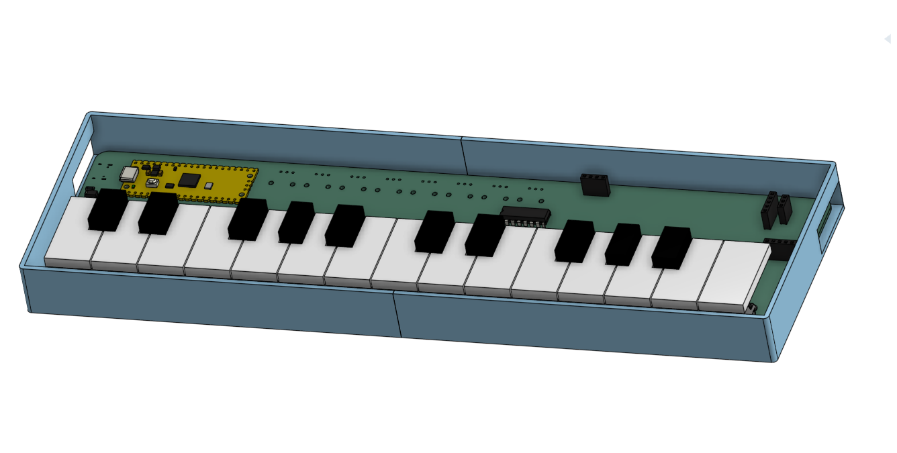
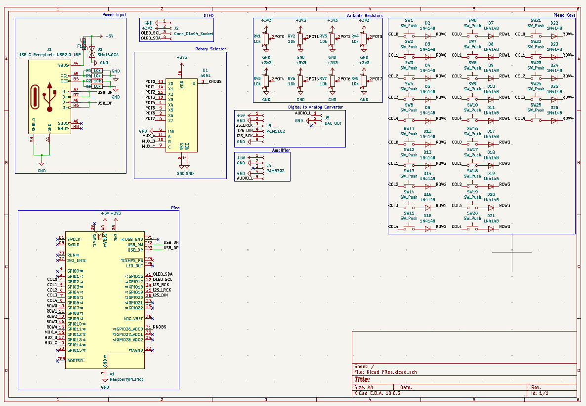
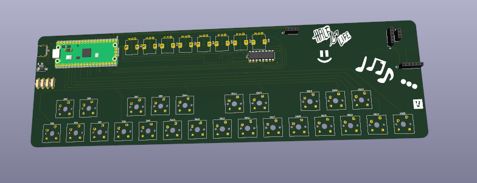
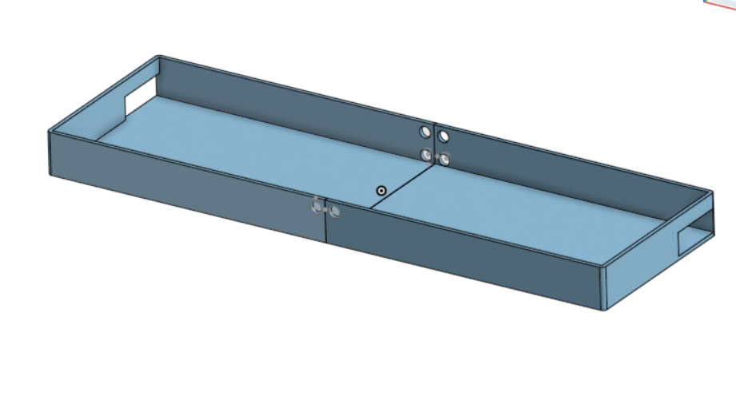

# Polyphonic Synthesizer

## Overview

You're probably wondering why this is called a polyphonic synthesizer. Well, I thought it sounded fancier than "scrappy 2 octave piano". Anyway, this is my 2nd PCB project, made for the week 3, Instruments, of the [Half Life YSWS](halflife.hackclub.com) from Hack Club.

As a former unskilled piano player (AMEB G6), I decided to make an electronic keyboard this week cos why not. :))) 

Well, at least it's supposed to be an electric keyboard. I'm pretty sure the keys are a bit smaller than they actually are supposed to be, but at least their shape is recognisable, right?

## Schematics

Above is my final schematic for the Synthesizer. As you can see, it contains a USB-C receptacle, Raspberry Pi Pico, some OLEDs, 25 switches (1 per key for 25 keys), and 8 knobs for customised sound settings.

## Hardware and assembly

This is my PCB render of my project. 

Basically, you need a bunch of Cherry MX switches that you need to stick onto the squares at the bottom. 

Then, you gotta 3D print the white and black key files in [here](3D%20Models/STLs/), ideally in PLA or PETG filament. 

Next, you need to stick the holes of the 3D printed parts onto the stems of the switches, and there should be enough tolerance to stick it in easily.

There's also a bunch of soldering that you need to do for the electrical components, but aside from that it's pretty easy.

It is also important to note that the [enclosure](3D%20Models/STLs/enclosure.stl) is completely optional, and exists only to hold the PCB so it doesn't slide around if you're trying to play it. It does not in any way affect the functionality of the actual piano.

If you do print the enclosure, please note that it is too large for a standard 3D printer with a buildspace of 220mm x 220mm x 220mm, so I have already halved the box in the STL model, and all you gotta do is either superglue the halves together or zip tie the 2 halves together using the provided 6mm diameter zip tie holes. (Zip ties are recommended)

The enclosure also has 2 holes for the USB cable and also the audio jack. Place the PCB inside it accordingly. 

You may also notice that there is absolutely no top panel or lid for the enclosure. Please note that this is **intended**. so you can see my beautiful silkscreen art and also I do not have any access to hinges :CC

## Features

I dont even have much to say here, it's just a regular piano?? If you're seeing this and you're a music student then this is a sign to go back to studying music theory.

- Optional Ear/Headphone support (there's an audio jack but you don't need to use it. unfortunately no bluetooth support :C)
- Feels like an actual electronic keyboard (cos of the keyswitches =DDD)
- Adjustable knobs (edit: im done programming firmware! :3)

| Knob | What it does                                                                             |
|---|------------------------------------------------------------------------------------------|
| **Volume** | how loud the thingy is                                                                   |
| **Instrument** | switches between 5 sounds: Piano, Organ, Pluck, Bell and 8-bit                           |
| **Tone** | makes it darker or brighter, like turning the treble down/up                             |
| **Attack** | how fast a note fades in, turn up for a swell similar to a violin                        |
| **Release** | basically a damper pedal                                                                 |
| **Echo** | adds repeating echoes                                                                    |
| **Octave** | shifts the keyboard +/- 2 octaves so you can basically get the range of the entire piano |
| **Transpose** | shifts every note +/- 6 semitones in case you get bored of your key                      |

- The OLED shows the current instrument, octave and transpose, a bar when you turn a knob, and the notes you're holding.

## Firmware

The Firmware for this project is programmed in Arduino IDE.

## AI Usage

No AI used in this project.

## Bill of Materials

### Grant-funded ($30 USD)

| Item | Purpose | Qty | Price | Source |
|---|---|---|---|---|
| Custom PCB 300×90mm, 2-layer (incl. shipping, $5 JLCONE coupon) | Main board | 5 | US$23.25 | [JLCPCB](https://jlcpcb.com) |
| USB-C receptacle HRO TYPE-C-31-M-12 | Power + USB data | 5 | US$0.87 | [LCSC](https://www.lcsc.com/product-detail/C165948.html) |
| SMAJ5.0CA TVS diode | USB ESD protection | 20 | US$0.61 | [LCSC](https://www.lcsc.com/product-detail/C908809.html) |
| SMD1206-050-16 500mA polyfuse | USB overcurrent protection | 10 | US$0.43 | [LCSC](https://www.lcsc.com/product-detail/C46641014.html) |
| Raspberry Pi Pico RP2040 (micro USB) + free knob caps (incl. GST) | Microcontroller | 1 | US$3.16 | [AliExpress](https://www.aliexpress.com/item/1005004565422217.html) |
| **Grant total** | | | **US$28.32** | |

### Paid out of pocket

| Item | Purpose | Qty | Price | Source |
|---|---|---|---|---|
| Gateron G Pro 3.0 MX switches (30pc) | Keys (25 needed, 8 leftover from Starbie) | 1 pack | AU$5.49 | [AliExpress](https://www.aliexpress.com/item/1005010559544082.html) |
| 1N4148 DO-35 diodes (50pc) | Key matrix anti-ghosting | 1 pack | AU$2.83 | [AliExpress](https://www.aliexpress.com/item/1005012020521505.html) |
| RV09 10K vertical potentiometers (5pc) | 8 control knobs | 2 packs | AU$2.78 | [AliExpress](https://www.aliexpress.com/item/1871188517.html) |
| CD4051BE DIP-16 | Analog mux for the 8 knobs | 1 | AU$2.44 | [AliExpress](https://www.aliexpress.com/item/1005012399429493.html) |
| 0.96" I2C OLED 128x64 | Display | 1 | AU$3.74 | [AliExpress](https://www.aliexpress.com/item/1005009784993412.html) |
| GY-PCM5102 I2S DAC module | Audio DAC + headphone jack | 1 | AU$4.19 | [AliExpress](https://www.aliexpress.com/item/1005005692721202.html) |
| PAM8302A CJMCU-832 amp module | Speaker amplifier | 1 | AU$2.50 | [AliExpress](https://www.aliexpress.com/item/1005007274382818.html) |
| 8Ω 1W 28mm speaker (2pc) | Speaker | 1 pack | AU$4.60 | [AliExpress](https://www.aliexpress.com/item/1005009051447480.html) |
| 10% GST | Tax | — | AU$2.86 | — |
| **Out-of-pocket total** | | | **AU$31.43 (US$21.98)** | |

### Already owned

| Item | Purpose | Qty |
|---|---|---|
| 10k resistors (1/4W) | USB-C CC pull-downs | 4 |

**Project total: US$50.30** *(AUD converted at AU$1 = US$0.6994)*